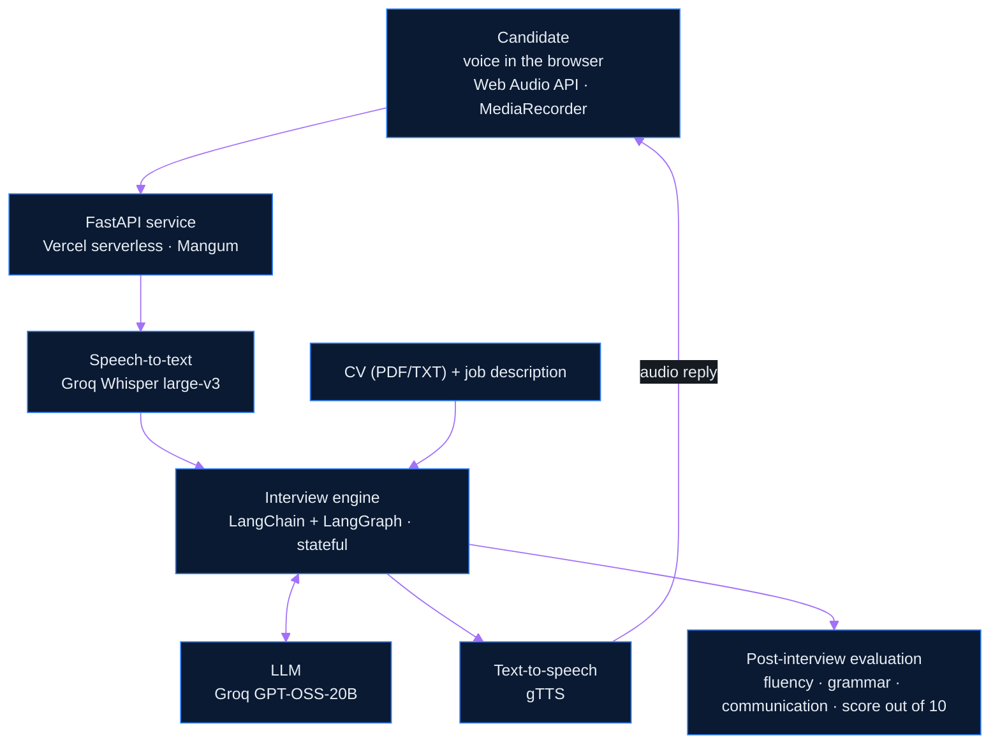

<!--
  Profile README · Abdallah Khalifa
  Palette: black #0d1117 · charcoal #161b22 · navy #0b1a33 · electric blue #2f81f7 / #58a6ff · purple #7b2cbf / #a371f7
  Badge and image URLs are defined once at the bottom of this file (reference-style links).
  To add a skill: copy an existing [b-*] definition at the bottom, then reference it as ![Name][b-name].
-->

<div align="center">


<h3>AI Engineer &nbsp;|&nbsp; Generative AI &nbsp;|&nbsp; Agentic AI &nbsp;|&nbsp; Machine Learning</h3>


<p>
I build LLM-powered applications, RAG pipelines and stateful AI agents,<br>
and ship them behind clean, deployable APIs.
</p>

[![Portfolio][btn-portfolio]](https://abdalllah.me)
[![LinkedIn][btn-linkedin]](https://www.linkedin.com/in/abdallllah/)
[![Email][btn-email]](mailto:abdallah.khalifa@proton.me)
[![GitHub][btn-github]](https://github.com/Iabdallllah)

<p>
<a href="#about"><b>About</b></a> &nbsp;·&nbsp;
<a href="#technical-expertise"><b>Expertise</b></a> &nbsp;·&nbsp;
<a href="#featured-projects"><b>Projects</b></a> &nbsp;·&nbsp;
<a href="#training-and-certifications"><b>Training</b></a> &nbsp;·&nbsp;
<a href="#education"><b>Education</b></a> &nbsp;·&nbsp;
<a href="#current-focus"><b>Focus</b></a> &nbsp;·&nbsp;
<a href="#github-activity"><b>Activity</b></a> &nbsp;·&nbsp;
<a href="#contact"><b>Contact</b></a>
</p>

</div>

![][hr]

<h2 align="center">About</h2>

I am an AI engineer focused on building LLM-powered applications end to end: retrieval pipelines, stateful agent workflows, and the APIs that put models in front of users. My work ranges from a real-time voice interview coach orchestrated with LangGraph, to RAG systems that answer only from retrieved context, to classical ML on IoT sensor data.

I integrate AI models into scalable solutions with Python, FastAPI, LangChain and LangGraph, aiming at systems that improve decision-making, streamline real-time workflows and automate repetitive work.

| Snapshot | |
| :-- | :-- |
| **Focus** | Generative AI · Agentic AI · Machine Learning · Deep Learning · MLOps |
| **Approach** | End-to-end model training, evaluation, optimization and scalable deployment |
| **Core stack** | Python · FastAPI · LangChain · LangGraph · PyTorch · TensorFlow · scikit-learn |
| **Open to** | Applied AI Engineering · Machine Learning · Data Science roles |

![][hr]

<h2 align="center">Technical Expertise</h2>

| Domain | Technologies |
| :-- | :-- |
| **Programming** | ![Python][b-python] ![SQL][b-sql] ![Bash][b-bash] |
| **AI and Machine Learning** | Machine Learning · Deep Learning (CNNs, RNNs/LSTMs) · NLP · Computer Vision<br>![scikit-learn][b-sklearn] ![TensorFlow][b-tensorflow] ![Keras][b-keras] ![PyTorch][b-pytorch] ![OpenCV][b-opencv] |
| **Generative AI** | LLMs · RAG · Prompt Engineering · Vector Search · Speech-to-Text and Text-to-Speech pipelines<br>![LangChain][b-langchain] ![Hugging Face][b-hf] ![FAISS][b-faiss] ![Groq][b-groq] |
| **Agentic AI** | AI Agents · Stateful Multi-Agent Workflow Orchestration<br>![LangGraph][b-langgraph] ![LangChain][b-langchain] |
| **Backend and APIs** | REST APIs · Model Serving<br>![FastAPI][b-fastapi] ![Flask][b-flask] ![Streamlit][b-streamlit] |
| **Tools and Infrastructure** | Version Control · Experiment Tracking · Serverless Deployment<br>![Git][b-git] ![GitHub][b-github] ![Linux][b-linux] ![MLflow][b-mlflow] ![Jupyter][b-jupyter] ![Vercel][b-vercel] |
| **Data** | ![NumPy][b-numpy] ![Pandas][b-pandas] ![Matplotlib][b-matplotlib] ![SQL][b-sql] |

<details>
<summary><b>Proficiency overview</b></summary>

<br>

| Domain | Level | Details |
| :-- | :--: | :-- |
| **Generative AI** | Advanced | LLMs, RAG, Agentic AI, Prompt Engineering, LangChain, AI Application Development |
| **Machine Learning** | Advanced | Scikit-learn, Model Evaluation and Optimization |
| **Deep Learning** | Advanced | TensorFlow, Keras, PyTorch, Neural Networks, CNNs, RNNs/LSTMs |
| **Data Processing** | Advanced | NumPy, Pandas |
| **Computer Vision** | Intermediate | OpenCV |
| **MLOps** | Intermediate | MLflow, API Development (FastAPI, Flask), Model Deployment, Version Control, Reproducibility |
| **Programming** | Proficient | Python, SQL, Git/GitHub, Jupyter Notebook, VS Code, Linux, Bash |
| **Soft Skills** | Proficient | Problem Solving, Analytical Thinking, Communication, Teamwork, Adaptability, Time Management |

</details>

![][hr]

<h2 align="center">Featured Projects</h2>

<p align="center">
Selected work across agentic systems, RAG, applied machine learning and AI products.<br>
Each card links to the source code and, where deployed, a live demo.
</p>

<!-- ───────────── 1 · Voxora (Agentic AI) ───────────── -->

| Voxora | Real-time AI interview coaching platform · [Live demo](https://voxorai.vercel.app) · [Source](https://github.com/Iabdallllah/Voxora) |
| :-- | :-- |
| **Problem** | Mock interviews are hard to practice alone: static question lists ignore the candidate's CV and the target role, and feedback is rarely structured. |
| **Solution** | A fully voice-based AI interviewer that reads the candidate's CV and the job description, runs an adaptive interview, and delivers a structured evaluation afterwards. |
| **Architecture** | Browser client (Web Audio API, MediaRecorder) → FastAPI service → Groq Whisper speech-to-text → LangChain + LangGraph interview engine ↔ Groq GPT-OSS-20B → gTTS speech synthesis. Deployed serverless on Vercel. |
| **Stack** | ![Python][b-python] ![FastAPI][b-fastapi] ![LangChain][b-langchain] ![LangGraph][b-langgraph] ![Groq][b-groq] ![Whisper][b-whisper] ![gTTS][b-gtts] ![Vercel][b-vercel] |
| **Highlights** | • Interviews run in Arabic, English or German, detected from the job description<br>• Hands-free conversation using Voice Activity Detection, with mid-speech interruption<br>• Adaptive follow-up questions driven by the CV (PDF/TXT) and the candidate's previous answers<br>• Post-session report covering fluency, grammar, communication, technical and behavioral feedback, strengths, improvement areas and an overall score out of 10 |

<details open>
<summary><b>Voxora request flow</b></summary>



</details>

<br>

<!-- ───────────── 2 · ChatPDF (RAG) ───────────── -->

| Chat with PDF | RAG-powered document question answering · [Source](https://github.com/Iabdallllah/Chat_PDF) |
| :-- | :-- |
| **Problem** | Finding answers inside long PDFs is slow, and a general-purpose LLM will answer without being grounded in the document. |
| **Solution** | A Retrieval-Augmented Generation pipeline that answers natural-language questions about a PDF using only the passages retrieved from it, and replies `Information not found` when the context has no answer. |
| **Architecture** | `PDF → text extraction (PyPDF2) → overlapping chunks → embeddings (all-MiniLM-L6-v2) → FAISS index (IndexFlatL2) → top-k retrieval → Gemma 2B Instruct → answer` |
| **Stack** | ![Python][b-python] ![PyTorch][b-pytorch] ![Hugging Face][b-hf] ![FAISS][b-faiss] ![Jupyter][b-jupyter] |
| **Highlights** | • Grounded generation with an explicit fallback to limit unsupported answers<br>• Configurable chunk size, overlap and number of retrieved passages<br>• Runs open models locally (Gemma 2B Instruct), with no hosted-LLM dependency |

<br>

<!-- ───────────── 3 · Irrigation Advisor (Machine Learning) ───────────── -->

| Intelligent Crop Irrigation Advisor | ML-powered smart irrigation from IoT sensor data · [Source](https://github.com/Iabdallllah/Intelligent-Crop-Irrigation-Advisor) |
| :-- | :-- |
| **Problem** | Fixed irrigation schedules ignore real field conditions, which wastes water and can hurt yield. |
| **Solution** | An ML system that learns from IoT sensor data to predict optimal watering schedules from soil, temperature, humidity and rainfall, to improve water efficiency and crop yield. |
| **Architecture** | `Sensor readings (soil, temperature, humidity, rainfall) → data preparation (Pandas, NumPy) → scikit-learn model → predicted watering schedule`, with Matplotlib for analysis |
| **Stack** | ![Python][b-python] ![scikit-learn][b-sklearn] ![Pandas][b-pandas] ![NumPy][b-numpy] ![Matplotlib][b-matplotlib] ![Jupyter][b-jupyter] |
| **Highlights** | • Multi-variable prediction from four environmental signals<br>• Local / edge-oriented design |

<br>

<!-- ───────────── 4 · AI Resume Parser (AI application) ───────────── -->

| AI Resume Parser | ATS CV dashboard for resume screening · [Live demo](https://cv-parser.streamlit.app/) · [Source](https://github.com/Iabdallllah/AI-Resume-Parser) |
| :-- | :-- |
| **Problem** | Screening large numbers of CVs against a job description is repetitive and hard to keep consistent. |
| **Solution** | A Streamlit dashboard for ATS-style CV processing: single and batch CV upload, job-description matching, skill-match results and analytics. |
| **Architecture** | Modular multi-page Streamlit app (Dashboard, CV Processing, Analytics, Settings) with session-state management, built to integrate with a FastAPI backend through a configurable API endpoint. |
| **Stack** | ![Python][b-python] ![Streamlit][b-streamlit] ![Jupyter][b-jupyter] |
| **Highlights** | • KPI overview with recent uploads and top candidate matches<br>• Analytics export to CSV, Excel and JSON<br>• Dark-theme interface with custom metric cards, deployed on Streamlit Cloud |

<br>

**More work**

| Project | What it does | Tech |
| :-- | :-- | :-- |
| [YouTube Video Summarizer](https://github.com/Iabdallllah/Youtube-Video-Summarizer) | Summarizes a YouTube video from its transcript: fetches the English transcript, splits it into chunks, summarizes each chunk with BART, and merges the results into one summary. | Hugging Face Transformers · `facebook/bart-large-cnn` · `youtube-transcript-api` |
| [GTC Hand Gesture Recognition](https://github.com/GTC-Hand-Gesture-Recognition/GTC-Hand-Gesture-Recognition) | Hand gesture recognition project. | Jupyter Notebook |

![][hr]

<h2 align="center">Training and Certifications</h2>

| Year | Program |
| :-: | :-- |
| 2026 | **Agentic AI and Generative AI System Developer** · DEPI<br>Comprehensive training in building agentic AI systems and generative AI applications.<br>`Python` `LangChain` `LangGraph` `AI Agents` `RAG` |
| 2026 | **LLMs Intern** · Tips Hindawi<br>Applied LLMs internship focused on building real-world AI-powered projects.<br>`Large Language Models` `Prompt Engineering` `AI Application Development` |
| 2026 | **Machine Learning Trainee** · GTC<br>Intensive machine learning training program.<br>`Machine Learning` `Scikit-learn` `Model Optimization` |

![][hr]

<h2 align="center">Education</h2>

**B.Sc. in Computer Science** · Faculty of Science, Alexandria University<br>
Expected graduation: **June 2027**

**Relevant coursework:** Data Structures and Algorithms · Statistics · Database Systems · Artificial Intelligence · Machine Learning · Data Visualization · Computer Networks

**Languages:** Arabic (Native) · English (B2) · German (B2)

![][hr]

<h2 align="center">Current Focus</h2>

```yaml
Current_Status:
  Learning:
    - Advanced LLM application development
    - Deepening knowledge in Agentic AI and LangChain
  Building:
    - Intelligent systems utilizing RAG pipelines
    - End-to-end ML models with FastAPI/Flask integration
  Exploring:
    - Optimization techniques for Neural Networks (CNNs/RNNs)
    - Robust MLOps workflows using MLflow
  Open_To:
    - Applied AI Engineering roles
    - Machine Learning and Data Science opportunities
```

![][hr]

<h2 align="center">GitHub Activity</h2>

<div align="center">

<!-- Row 1: width="420" keeps two cards side by side on desktop and stacks them on mobile -->


<br>


<br>


<br>

<picture>
  <source media="(prefers-color-scheme: dark)" srcset="https://raw.githubusercontent.com/Iabdallllah/Iabdallllah/output/github-contribution-grid-snake-dark.svg">
  
</picture>

</div>

![][hr]

<h2 align="center">Contact</h2>

| | |
| :-- | :-- |
| **Portfolio** | [abdalllah.me](https://abdalllah.me) |
| **LinkedIn** | [linkedin.com/in/abdallllah](https://www.linkedin.com/in/abdallllah/) |
| **Email** | [abdallah.khalifa@proton.me](mailto:abdallah.khalifa@proton.me) |
| **GitHub** | [github.com/Iabdallllah](https://github.com/Iabdallllah) |
| **Phone** | +20 120 885 9892 |
| **Location** | Alexandria, Egypt |

<p align="center">
Open to Applied AI Engineering, Machine Learning and Data Science roles.
</p>

<!--
  Coding profiles (hidden: the original links were placeholders).
  Add your real profile URLs and uncomment.

  [](https://leetcode.com/u/YOUR-HANDLE)
  [](https://www.geeksforgeeks.org/user/YOUR-HANDLE)
  [](https://www.hackerrank.com/profile/YOUR-HANDLE)
-->

<div align="center">


</div>

<!-- ═════════════ Reference definitions: dividers and buttons ═════════════ -->

[hr]: https://capsule-render.vercel.app/api?type=rect&color=0:0d1117,50:2f81f7,100:0d1117&height=2

[btn-portfolio]: https://img.shields.io/badge/PORTFOLIO-abdalllah.me-161b22?style=for-the-badge&labelColor=1f6feb
[btn-linkedin]: https://img.shields.io/badge/LINKEDIN-in%2Fabdallllah-161b22?style=for-the-badge&labelColor=1f6feb
[btn-email]: https://img.shields.io/badge/EMAIL-Proton_Mail-161b22?style=for-the-badge&labelColor=1f6feb
[btn-github]: https://img.shields.io/badge/GITHUB-Iabdallllah-161b22?style=for-the-badge&labelColor=1f6feb

<!-- ═════════════ Reference definitions: technology badges ═════════════ -->

[b-python]: https://img.shields.io/badge/Python-0b1a33?style=flat-square&logo=python&logoColor=4da3ff&labelColor=0b1a33
[b-sql]: https://img.shields.io/badge/SQL-0b1a33?style=flat-square&labelColor=0b1a33
[b-bash]: https://img.shields.io/badge/Bash-0b1a33?style=flat-square&logo=gnubash&logoColor=4da3ff&labelColor=0b1a33

[b-sklearn]: https://img.shields.io/badge/scikit--learn-0b1a33?style=flat-square&logo=scikitlearn&logoColor=4da3ff&labelColor=0b1a33
[b-tensorflow]: https://img.shields.io/badge/TensorFlow-0b1a33?style=flat-square&logo=tensorflow&logoColor=4da3ff&labelColor=0b1a33
[b-keras]: https://img.shields.io/badge/Keras-0b1a33?style=flat-square&logo=keras&logoColor=4da3ff&labelColor=0b1a33
[b-pytorch]: https://img.shields.io/badge/PyTorch-0b1a33?style=flat-square&logo=pytorch&logoColor=4da3ff&labelColor=0b1a33
[b-opencv]: https://img.shields.io/badge/OpenCV-0b1a33?style=flat-square&logo=opencv&logoColor=4da3ff&labelColor=0b1a33

[b-langchain]: https://img.shields.io/badge/LangChain-0b1a33?style=flat-square&logo=langchain&logoColor=4da3ff&labelColor=0b1a33
[b-langgraph]: https://img.shields.io/badge/LangGraph-0b1a33?style=flat-square&labelColor=0b1a33
[b-hf]: https://img.shields.io/badge/Hugging_Face-0b1a33?style=flat-square&logo=huggingface&logoColor=4da3ff&labelColor=0b1a33
[b-faiss]: https://img.shields.io/badge/FAISS-0b1a33?style=flat-square&labelColor=0b1a33
[b-groq]: https://img.shields.io/badge/Groq-0b1a33?style=flat-square&labelColor=0b1a33
[b-whisper]: https://img.shields.io/badge/Whisper_STT-0b1a33?style=flat-square&labelColor=0b1a33
[b-gtts]: https://img.shields.io/badge/gTTS-0b1a33?style=flat-square&labelColor=0b1a33

[b-fastapi]: https://img.shields.io/badge/FastAPI-0b1a33?style=flat-square&logo=fastapi&logoColor=4da3ff&labelColor=0b1a33
[b-flask]: https://img.shields.io/badge/Flask-0b1a33?style=flat-square&logo=flask&logoColor=4da3ff&labelColor=0b1a33
[b-streamlit]: https://img.shields.io/badge/Streamlit-0b1a33?style=flat-square&logo=streamlit&logoColor=4da3ff&labelColor=0b1a33

[b-git]: https://img.shields.io/badge/Git-0b1a33?style=flat-square&logo=git&logoColor=4da3ff&labelColor=0b1a33
[b-github]: https://img.shields.io/badge/GitHub-0b1a33?style=flat-square&logo=github&logoColor=4da3ff&labelColor=0b1a33
[b-linux]: https://img.shields.io/badge/Linux-0b1a33?style=flat-square&logo=linux&logoColor=4da3ff&labelColor=0b1a33
[b-mlflow]: https://img.shields.io/badge/MLflow-0b1a33?style=flat-square&logo=mlflow&logoColor=4da3ff&labelColor=0b1a33
[b-jupyter]: https://img.shields.io/badge/Jupyter-0b1a33?style=flat-square&logo=jupyter&logoColor=4da3ff&labelColor=0b1a33
[b-vercel]: https://img.shields.io/badge/Vercel-0b1a33?style=flat-square&logo=vercel&logoColor=4da3ff&labelColor=0b1a33

[b-numpy]: https://img.shields.io/badge/NumPy-0b1a33?style=flat-square&logo=numpy&logoColor=4da3ff&labelColor=0b1a33
[b-pandas]: https://img.shields.io/badge/Pandas-0b1a33?style=flat-square&logo=pandas&logoColor=4da3ff&labelColor=0b1a33
[b-matplotlib]: https://img.shields.io/badge/Matplotlib-0b1a33?style=flat-square&labelColor=0b1a33
